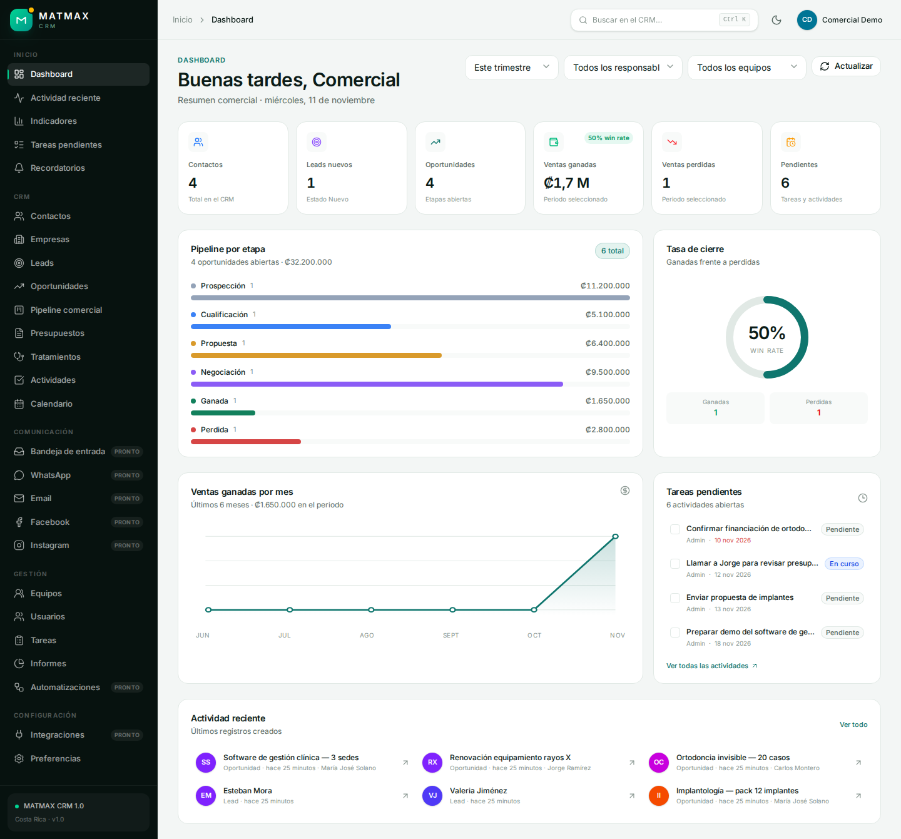
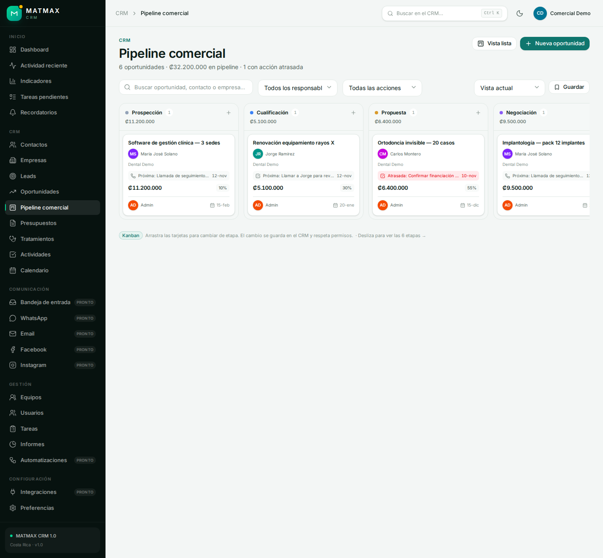
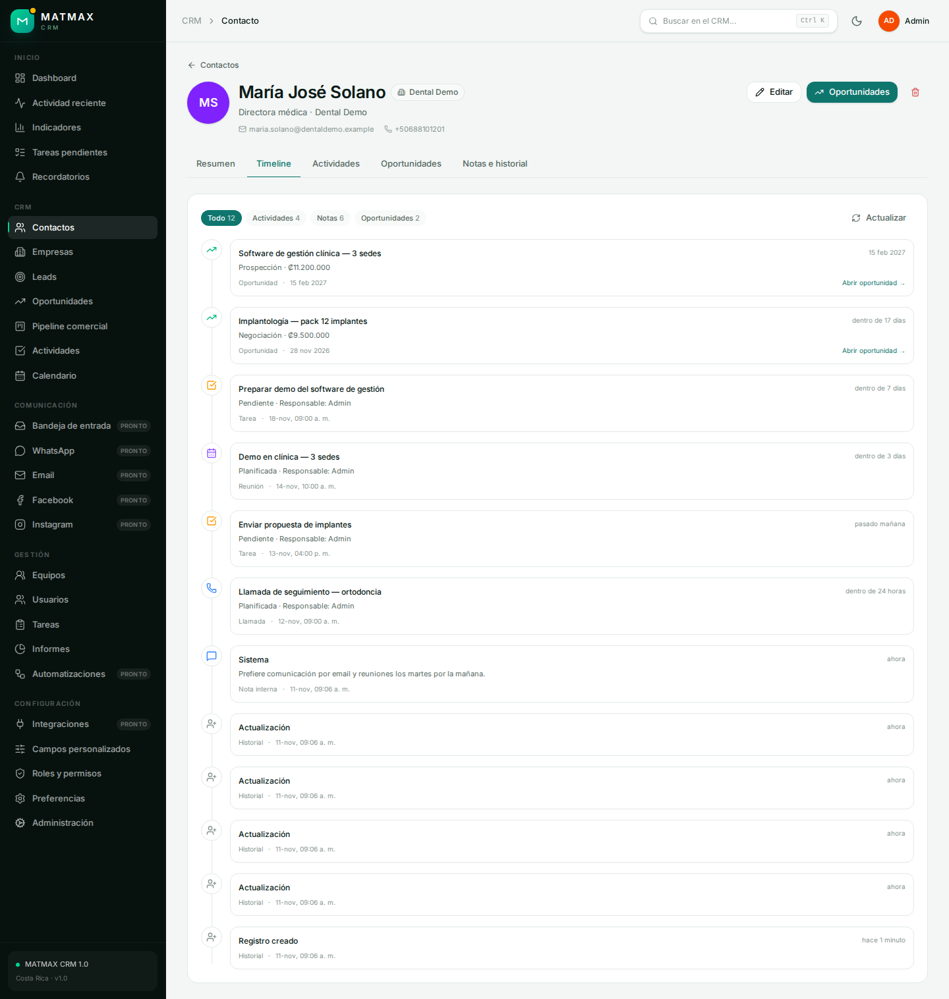
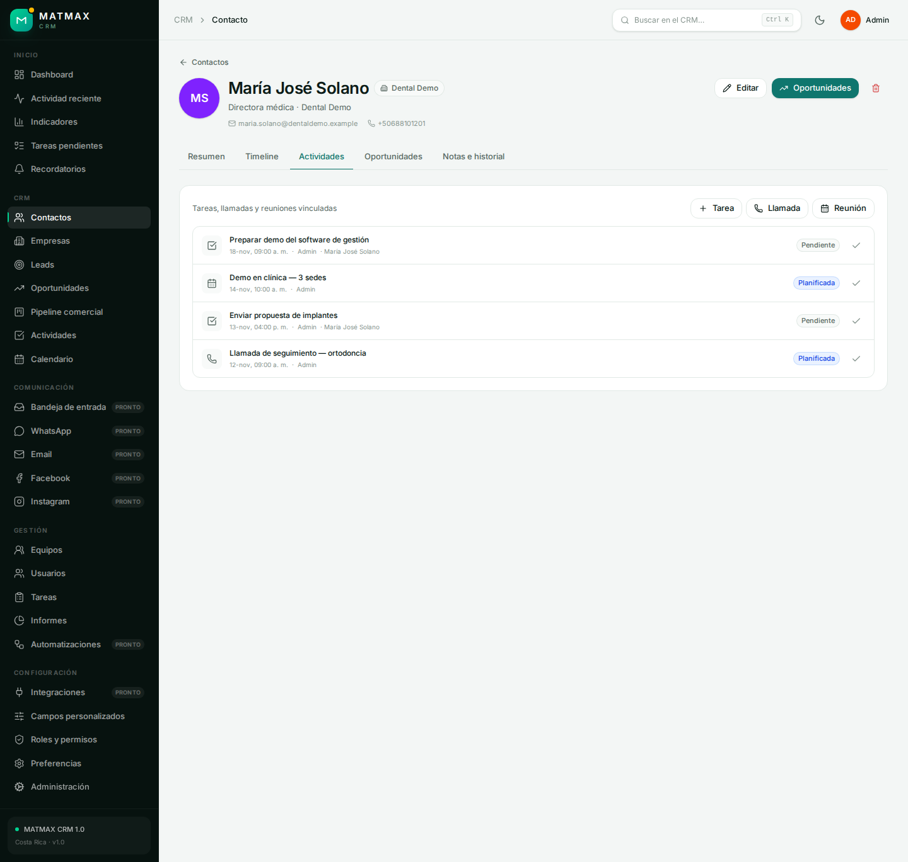
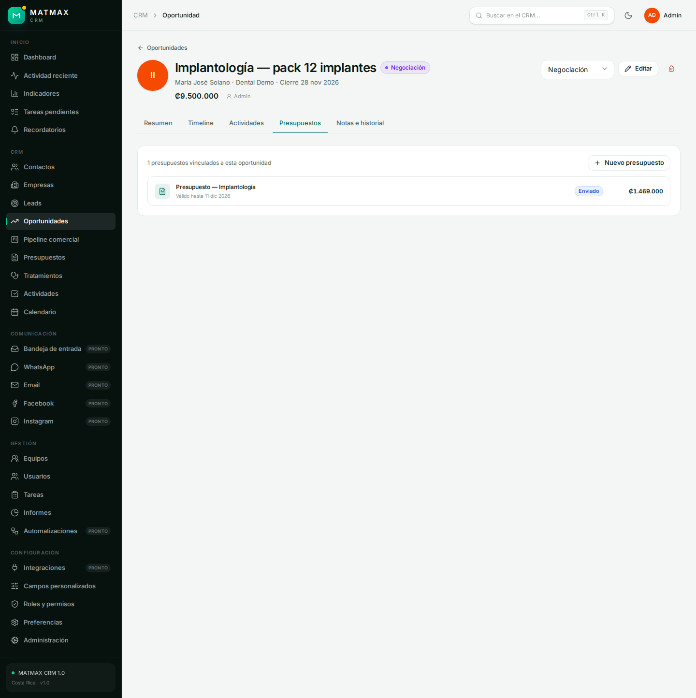
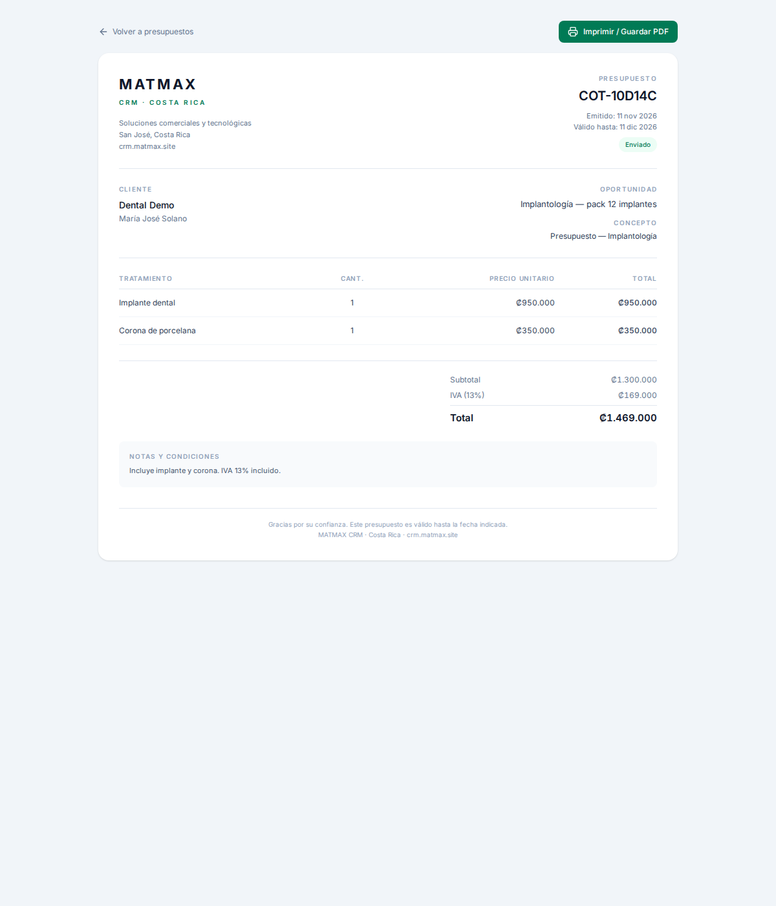
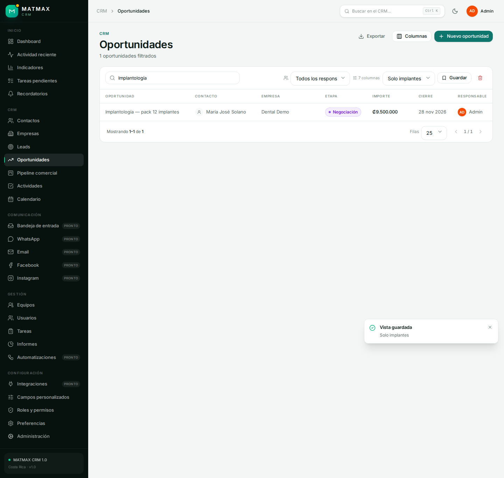

# Manual del empleado — MATMAX CRM

> Versión visual para imprimir: [Guía rápida en PDF](GUIA-RAPIDA-EMPLEADO.pdf).

Guía rápida para un usuario con rol **Ventas**. No necesitas conocimientos técnicos.

---

## 1. Entrar al CRM

1. Abre <https://crm.matmax.site>.
2. Introduce tu usuario y contraseña.
3. La primera vez, cambia la contraseña temporal desde la administración o pídesela al administrador.

Usuario demo para pruebas:

- Usuario: `comercial`
- Contraseña: consultar `.secrets/comercial-credentials.txt` en el servidor.
- Rol: **Ventas** · Equipo: **Comercial**

---

## 2. Lo que verás al entrar

El menú lateral del comercial tiene:

- **Inicio:** Dashboard, Actividad reciente, Indicadores, Tareas pendientes, Recordatorios.
- **CRM:** Contactos, Empresas, Leads, Oportunidades, Pipeline comercial, Presupuestos, Tratamientos, Actividades y Calendario.
- **Comunicación:** canales pendientes de configurar (WhatsApp, Email, redes).
- **Gestión:** Equipos, Usuarios, Tareas e Informes.
- **Configuración:** Preferencias.

No verás la administración técnica, los roles ni la edición del catálogo de tratamientos: eso es del administrador.

---

## 3. Tu rutina diaria

### Paso 1 — Revisa el Dashboard

Al entrar verás:

- Contactos, leads nuevos y oportunidades abiertas.
- Ventas ganadas y perdidas del periodo.
- Pipeline por etapa.
- **Tareas pendientes** y cuántas actividades hay abiertas.
- Actividad reciente.

Empieza por las tareas pendientes y por las tarjetas con **acción atrasada**.

### Paso 2 — Revisa tus tareas y actividades

Entra en **Tareas pendientes** o **Actividades**.

- Las tareas tienen estado, prioridad y fecha.
- Puedes marcarlas como completadas con el check.
- Las llamadas y reuniones tienen fecha de inicio y estado.

### Paso 3 — Trabaja el pipeline

Cada tarjeta muestra:

- **Contacto** y empresa.
- Importe y probabilidad.
- Responsable y fecha de cierre.
- **Próxima acción** o **acción atrasada** en rojo.

Puedes arrastrar una tarjeta a otra etapa. El cambio se guarda en el CRM.

Usa los filtros:

- Buscar por oportunidad, contacto o empresa.
- Filtrar por responsable.
- Filtrar por acción atrasada, próxima o sin acción.
- Guardar una **vista** para tu usuario.

### Paso 4 — Abre la oportunidad y revisa el contacto

Haz clic en una tarjeta o en **Oportunidades**.

Dentro de la oportunidad verás:

- Contacto, empresa, importe, etapa y cierre.
- Pestaña **Timeline:** notas, historial, actividades y oportunidades en un solo hilo.
- Pestaña **Actividades:** tareas, llamadas y reuniones.
- Pestaña **Presupuestos:** presupuestos de esa oportunidad.
- Notas e historial.

### Paso 5 — Registra una llamada, reunión o tarea

En la ficha del contacto o de la oportunidad:

1. Pulsa **Llamada**, **Reunión** o **Tarea**.
2. Escribe el nombre.
3. Selecciona el **contacto** o la empresa.
4. Define fecha, estado y responsable.
5. Guarda.

La actividad aparecerá en la ficha del contacto, en la empresa, en el calendario y en la timeline.

### Paso 6 — Crea un presupuesto

1. Abre la oportunidad.
2. Entra en **Presupuestos**.
3. Pulsa **Nuevo presupuesto**.
4. Selecciona la oportunidad.
5. Añade tratamientos del catálogo o líneas manuales.
6. Ajusta cantidades y precios.
7. Revisa el **IVA 13%** y el total.
8. Guarda.

### Paso 7 — Genera el PDF

Dentro del presupuesto, pulsa **PDF**.

Se abre una hoja limpia con los datos del cliente, las líneas, el IVA y el total. Pulsa **Imprimir / Guardar PDF** y elige **Guardar como PDF** en el navegador.

### Paso 8 — Avanza la oportunidad

- Cuando el cliente acepte, arrastra la tarjeta a **Ganada**.
- Si se pierde, a **Perdida**.
- Registra la siguiente acción para no dejar la oportunidad sin seguimiento.

---

## 4. Leads: de prospecto a cliente

1. Entra en **Leads**.
2. Abre el lead.
3. Pulsa **Convertir**.
4. Revisa empresa, contacto y oportunidad.
5. Confirma.

El lead pasa a **Convertido** y se crean los tres registros enlazados. Si hay un duplicado, el sistema avisa antes de continuar.

---

## 5. Búsqueda y atajos

- **Buscador superior:** busca en todo el CRM.
- **Ctrl + K / ⌘ + K:** abre la búsqueda rápida.
- **Vistas guardadas:** en Pipeline y listados, guarda búsqueda, responsable, acción y columnas.
- **Preferencias:** tema claro/oscuro, perfil y preferencias personales.

---

## 6. Qué puede hacer un comercial

- Ver y editar contactos, empresas, leads y oportunidades de su equipo.
- Crear y completar tareas, llamadas y reuniones.
- Convertir leads.
- Crear y editar presupuestos de su equipo.
- Consultar el catálogo de tratamientos.
- Ver informes y actividad reciente.
- Guardar vistas.

## 7. Qué no puede hacer

- Crear o modificar tratamientos (solo lectura).
- Borrar presupuestos.
- Cambiar roles, usuarios o configuración técnica.
- Acceder a la administración nativa.
- Ver registros de otros equipos si el ACL es por equipo.

---

## 8. Buenas prácticas

1. **Toda oportunidad debe tener un contacto.**
2. **Toda oportunidad debe tener una próxima acción.**
3. Actualiza la etapa después de cada conversación.
4. Registra la llamada o reunión el mismo día.
5. Usa notas y timeline para que el equipo sepa qué pasó.
6. Revisa el presupuesto antes de enviarlo: validez, IVA y datos del cliente.
7. Si no hay siguiente paso, la oportunidad está en riesgo.

---

## 9. Problemas frecuentes

| Problema | Solución |
|---|---|
| No veo un registro | Revisa el filtro de responsable/equipo y tus permisos |
| No puedo crear un tratamiento | Es correcto: el catálogo lo gestiona el administrador |
| No puedo borrar un presupuesto | El rol Ventas no tiene borrado; pide al administrador |
| El PDF no sale | Pulsa **PDF** y luego **Imprimir / Guardar PDF**; elige “Guardar como PDF” |
| La sesión caducó | Vuelve a iniciar sesión |

Para soporte: contacta al administrador de MATMAX CRM.

---

## 10. Las dos puertas: CRM y Administración

MATMAX CRM tiene **dos interfaces** conectadas a la misma base de datos:

| | CRM principal | Administración nativa |
|---|---|---|
| URL | <https://crm.matmax.site> | <https://crm.matmax.site:8443> |
| Para quién | Todo el equipo comercial | Solo administradores |
| Aspecto | Interfaz MATMAX moderna | Interfaz original de EspoCRM |
| Uso | Trabajo diario: pipeline, contactos, actividades, presupuestos | Configuración: usuarios, roles, campos, entidades, ajustes |
| Módulos custom | Tratamientos, Presupuestos, Timeline, próximas acciones, vistas guardadas | Solo aparecen si se añaden layouts/menús nativos; no es necesario |

### ¿Por qué la administración tiene menos módulos?

Porque `:8443` **no es la aplicación comercial**: es el panel técnico del motor EspoCRM.

- La SPA de `crm.matmax.site` es la aplicación que construimos para el equipo: agrega datos, añade Timeline, próximas acciones, vistas guardadas y presupuestos.
- La administración nativa es la interfaz de fábrica de EspoCRM: muestra las entidades base y las herramientas de configuración.
- Las entidades `CTreatment` y `CCQuote` se crearon para la SPA; no se añadieron al menú nativo porque el empleado no debe entrar ahí.
- Los permisos del rol también hacen que un comercial vea menos opciones que un administrador.

### Regla práctica

- **Empleado:** solo `https://crm.matmax.site`.
- **Administrador:** `https://crm.matmax.site` para trabajar y `https://crm.matmax.site:8443` solo para configurar.
- Los datos son los mismos: un contacto, oportunidad o presupuesto creado en la SPA se guarda en la misma base de datos.

Si alguna vez necesitas que Tratamientos o Presupuestos aparezcan también dentro de la administración nativa, se pueden añadir layouts y pestañas; no es necesario para el uso diario.
